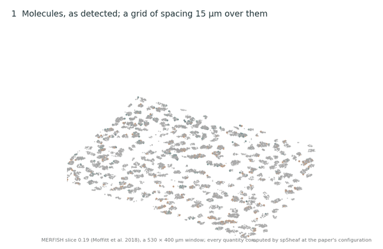
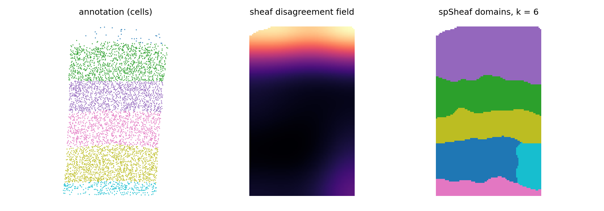

# spSheaf

Sheaf-theoretic spatial domain inference from raw molecules, without cell
segmentation. spSheaf places kernel-smoothed expression fibers on a grid,
gives each vertex a local principal-subspace stalk, scores every edge by its
*sheaf disagreement* — the residual mismatch of neighbouring local coordinates
after the stalks are aligned — and attenuates those transitions during
clustering. Paluzo-Hidalgo, Maehara & Imoto (2026). Software archived at [doi:10.5281/zenodo.24065558](https://doi.org/10.5281/zenodo.24065558).



*The construction on real data (MERFISH slice 0.19 of Moffitt et al. 2018, a
530 × 400 µm window; every quantity computed by spSheaf at the paper's
settings). Molecules and the 15 µm grid; the Gaussian-kernel fiber of one grid
point and one of its components as a smoothed field; the kNN graph; the stalks
standing over the vertices; one edge across an interface, its two stalks
aligned by the SVD of their overlap and the disagreement D(e) between the
transported coordinates; every edge scored; the smoothed boundary field over
the tissue; the domains.*

## Install

```bash
pip install spsheaf                  # Python >= 3.9; numpy, scipy, scikit-learn, pandas
pip install -e .                     # from a clone, for the experiments and figures
pip install -r requirements-lock.txt # exact versions the results were produced on
```

## Quickstart

`examples/quickstart.py` downloads one public section — the SpaceTx BaristaSeq mouse visual cortex,
0.32 million molecules, 81 genes — runs the eight steps at the paper's
settings for it, and draws the domains next to the authors' layer
annotation. One minute on a laptop, no other data needed:

```bash
pip install spsheaf matplotlib
python examples/quickstart.py        # writes examples/quickstart_domains.png; ARI 0.77 against the six layers
```



`examples/tutorial.ipynb` is the same section step by step, with every
intermediate drawn (fibers, stalks, the disagreement field), what each
parameter does, the comparison with the annotation per layer, and how to
choose the number of domains with the silhouette when there is no
annotation. It runs in under a minute; the executed outputs are kept in the
notebook.

The whole method is eight function calls on a molecule table with columns
`x`, `y`, `gene` (any units; the parameters are in those units):

```python
from spsheaf import fibers, graph, sheaf, clustering

grid, raw, genes = fibers.build_kernel_fibers(mol, grid_spacing=15, bandwidth=25, x_col="x", y_col="y")
fib    = fibers.normalize_fibers(raw)                               # 1  fibers on a grid
edges  = graph.build_spatial_graph(grid, k=6)                       # 2  spatial graph
stalks = sheaf.compute_stalks(fib, grid, uniform_dim=6, k_nbrs=50)  # 3  stalks: local principal subspaces
rs     = sheaf.compute_restriction_maps(stalks, edges, 6)           # 4  restriction maps by SVD alignment
b_raw, b_smooth = sheaf.compute_boundary_scores(fib, grid, stalks, edges, rs, smooth_radius=60)  # 5-6
labels = clustering.boundary_aware_clustering(fib, grid, b_smooth, edges, n_clusters=8)          # 7
labels, _ = clustering.spatial_cleanup(labels, edges, grid_coords=grid)                          # 8
```

`spsheaf.pipeline.run_single_slice` wraps the eight steps and the evaluation
against an annotation. Parameters: grid spacing `δ`, kernel bandwidth `h`,
stalk dimension `d`, smoothing radius `σ_s`, boundary weight `α_b`, spatial
weight `α_s`, and the coordinate reference of the stalk sections
(`SPSHEAF_REFERENCE=tissue|local`, default `tissue`: coordinates referenced
to the section mean; `local` references them to the neighbourhood mean, and
is what the tuning grid selects on the MERFISH benchmark). The number of
domains `k` is an input; `experiments/merfish/k_selection.py` computes the
silhouette over a range of `k`, and the paper recommends selecting within the
range where it lies within 0.002 of its maximum. `docs/package_api.md` lists
the modules.

## Reproduce the paper

Everything below this line is the paper's reproduction material; `pip install spsheaf` ships only `src/spsheaf/`.

Point the code at the data (`data/README.md` lists every input and where it
comes from):

```bash
export SPSHEAF_DATA=/path/to/data      # or copy paths.example.toml to paths.toml
```

Rebuild the figures from the stored tables (minutes, no raw data needed
except for the panel dumps under `data/results`):

```bash
make figures && make figures-verify   # 17 PDFs into figures/out/, checked against the 180 mm / 6-8 pt spec
```

Check a number without running anything: every spSheaf table in the paper is
under `reported/` (`reported/README.md` names the claim and the command behind
each file; `reported/tissue/` holds the runs repeated at the tissue reference);
the competitors' tables and per-cell labels are under
`benchmarks/segfree/results/` (`results_union/` for the selection over both
references). `make reported-check` and `make reported-tissue-check` fail if
either has drifted from its results tree.

Re-run the experiments (hours; raw inputs required):

```bash
SPSHEAF_REFERENCE=local make merfish merfish-seeds merfish-loo-cv   # Table 1, Fig 2b: five slices, 20 seeds, the 27-configuration grid
make merfish merfish-seeds merfish-loo-cv   # the same at the default (tissue) reference; the two grids together are the 54-row union
make revision                               # ablation, boundary evaluation, k sweep (Fig 2c/d)
make osmfish-all osmfish-insample osmfish-insample-tissue   # Fig 3, the 2 x 108 grid
make spacetx-all spacetx-ablation           # both SpaceTx sections, 162-configuration grids, ED 3, Supplementary Fig 3
make matched-selection-union benchmark-table   # one selection rule for all four methods (Table 1)
make k-selection merfish-k-selection merfish-k-split   # choosing k: synthetic calibration, the five slices, the divisions at k = 9 (ED 4, Fig 4)
make help                                   # everything else
```

The grids are resumable: interrupt and re-run, only missing configurations
are computed. The competitor sweeps (SSAM, Points2Regions, FICTURE) are
reproducible from the tracked metric tables; re-running them needs the
competitors' inputs, which `python -m benchmarks.segfree.inputs` names.

## Main results

ARI against the published annotation, every method tuned on its own grid on
the section it is scored on (Table 1 of the paper); the coordinate reference
is part of spSheaf's grid. MERFISH: one configuration per method over the
five slices.

| | MERFISH (5 slices) | osmFISH | Allen prototype MERFISH | BaristaSeq |
|---|---|---|---|---|
| **spSheaf** (selected reference) | **0.571** (local) | 0.673 (tissue) | **0.754** (tissue) | **0.757** (tissue) |
| spSheaf at the default, tissue | 0.548 | 0.673 | 0.754 | 0.757 |
| Points2Regions | 0.457 | 0.432 | 0.684 | 0.733 |
| SSAM | 0.401 | **0.729** | 0.410 | 0.738 |
| FICTURE | 0.342 | 0.465 | 0.475 | 0.631 |

On MERFISH the ranking holds under all three selection rules the five slices
allow — per-slice argmax 0.584 vs 0.510, one configuration 0.571 vs 0.457,
leave-one-slice-out 0.552 vs 0.388 — and spSheaf ranks first of twelve on
NMI against the SDMBench baselines. On osmFISH two of eleven layers are
recovered at no configuration; see `experiments/osmfish/`. On the MERFISH
benchmark at the local reference, ten ablation arms attribute +0.102 ARI to
the sheaf term over no weighting and +0.046 over a kernel baseline; at the
tissue reference the gain over the kernel baseline is 0.006, and on the two
SpaceTx sections no edge score separates from it (`reported/tissue/`).

## Layout

```
src/spsheaf/         the method (fibers, graph, sheaf, clustering, evaluation, pipeline); what `pip install spsheaf` ships
examples/            quickstart.py and tutorial.ipynb: one public section from molecules to domains
experiments/         one folder per dataset (synthetic/ for the k calibration); each README gives commands, inputs and outputs
benchmarks/segfree/  SSAM, Points2Regions and FICTURE under a matched protocol; results/, results_union/, results_tissue/ tracked
figures/             figure pipeline; out/ is generated, assets/ holds the few placed rasters
reported/            spSheaf's own result tables, one row per configuration (tracked); tissue/ for the runs at the default reference
tests/  tools/       unit tests; provenance and requirements scripts
docs/                package API; dev-notes/ are working notes
data/                untracked; data/README.md
```

## Licence

MIT.
